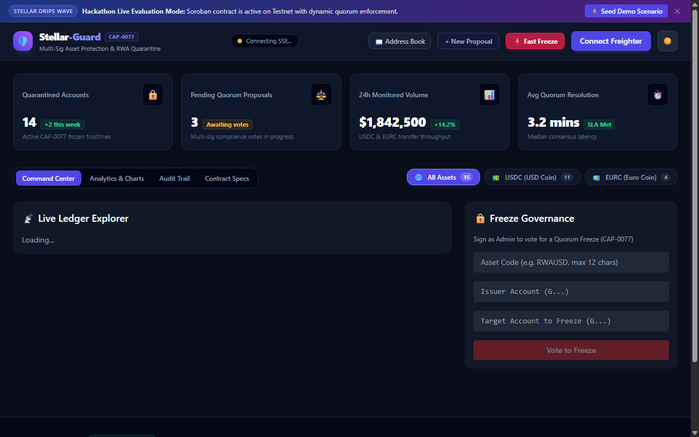
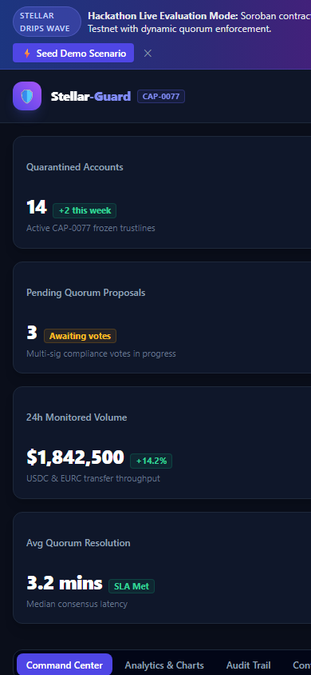

# ⚡ Stellar-Guard

[](https://stellar.org)
[](https://soroban.stellar.org)
[](https://github.com/stellar/stellar-protocol/blob/master/core/cap-0077.md)
[](https://stellar.org/developers)
[](https://stellar-guard.vercel.app)
[](LICENSE)
[-brightgreen.svg)](https://github.com/Virelis/Stellar-Guard/actions)

> **Institutional Multi-Signature Freeze Governance & Asset Protection for Regulated RWAs on Stellar.**  
> Built for the **Stellar Drips Wave** and the **Stellar Community Fund**.

---

## 🌐 Live Deployments & Network Artifacts

| Component | Network / Host | Details / Links |
| :--- | :--- | :--- |
| **Operator Dashboard** | Vercel Production | 🚀 [https://stellar-guard.vercel.app](https://stellar-guard.vercel.app) |
| **Soroban Smart Contract** | Stellar Testnet | [`CCM2U2RWZVKISBKOAUBCTSYA63GIYAVC4RRBZU4Q5KKY5ZOYN45LFYN4`](https://stellar.expert/explorer/testnet/contract/CCM2U2RWZVKISBKOAUBCTSYA63GIYAVC4RRBZU4Q5KKY5ZOYN45LFYN4) |
| **WASM Bytecode Hash** | Stellar Testnet | `e2a544b76cfc3c002357f081c39a7af26a5c242bde8f06fec82f4d534be6b42f` (43.49 KB) |
| **Contract Initialization Tx** | Stellar Testnet | [`bc20cb27a8dd0e21...`](https://stellar.expert/explorer/testnet/tx/bc20cb27a8dd0e21ea09d1da8ebeb77acace19b9b81f72397c112e9c228288b9) |
| **Backend REST API** | Express / TS | Local & Docker Compose (`http://localhost:4000`) |

---

## 📸 Product Showcase & Screenshots

### Command Center & Live Freeze Panel


### Emergency Mobile Alert Interface


---

## 🎯 The Problem & Our Solution

Every major regulated financial asset and fiat-backed stablecoin (USDC, EURC, tokenized US Treasuries) requires the ability to freeze illicit or court-ordered assets. However, **centralized single-admin keys represent catastrophic single points of failure (SPOF)** — vulnerable to employee sabotage, stolen laptops, and insider extortion.

**Stellar-Guard eliminates this vulnerability** by implementing **CAP-0077 and Soroban multi-signature quorum consensus**:
- **Dual-Control Enforcement:** No individual administrator can unilaterally freeze an account. Every action requires dynamic percentage quorum ($\ge 66\%$) from authorized trustees.
- **Evidence-Bound Proposals:** Every quarantine proposal cryptographically commits to an immutable IPFS forensic evidence dossier.
- **Off-Path High-Speed Payments:** Standard transfers settle at native Stellar speeds (~5s) and ultra-low fees (~0.00001 XLM). Only freeze proposals invoke smart contracts.
- **Automated Dispute Resolution:** Full on-chain unfreeze workflow to restore legitimate customer trustlines upon clearance.

---

## 🏛️ System Architecture

```
┌────────────────────────────────────────────────────────┐
│            Operator Governance Dashboard               │
│   Next.js 14 App Router | React 18 | Freighter Wallet  │
│   Quorum Meters | XDR Inspector | PDF Audit Export     │
└──────────────────────────┬─────────────────────────────┘
                           │ (SEP-0010 WebAuth)
                           ▼
┌────────────────────────────────────────────────────────┐
│            Backend Streaming & API Service             │
│   Express | Node:sqlite | Winston | Prometheus Metrics │
│   Persistent Horizon Cursor | AML Risk Scoring Engine  │
└──────────────────────────┬─────────────────────────────┘
                           │ (JSON-RPC 2.0 / XDR)
                           ▼
┌────────────────────────────────────────────────────────┐
│         Soroban Governance Smart Contract              │
│   Rust | Dynamic Quorum | CAP-0077 Quarantine Adapter  │
│   Whitelist Guard | Circuit Breaker | Rent Pruning     │
└────────────────────────────────────────────────────────┘
```

---

## 🚀 Quickstart (Under 3 Minutes)

### Option 1: One-Command Docker Sandbox
```bash
# Launch Standalone Stellar Node, Backend API, and Next.js Dashboard
docker compose up -d
```
- **Operator Dashboard:** http://localhost:3000
- **Backend API:** http://localhost:4000
- **Local Soroban RPC:** http://localhost:8000/soroban/rpc

### Option 2: Local Development Setup
```bash
# 1. Install dependencies across all monorepo workspaces
npm install

# 2. Build shared types package
npm run build --workspace=@stellar-guard/types

# 3. Run all unit and integration test suites
npm test

# 4. Launch development services
cd backend && npm run dev
cd frontend && npm run dev
```

---

## 💻 Enterprise CLI Tool

Stellar-Guard includes an official standalone command-line utility for automation and DevOps operators:

```bash
# Check on-chain governance and network status
npx @stellar-guard/cli status

# Propose an emergency asset quarantine
npx @stellar-guard/cli propose GA7Q... USDC --category EXPLOIT_DRAIN

# Cast an administrator approval signature
npx @stellar-guard/cli vote <PROPOSAL_ID> --approve
```

---

## 📚 Documentation & Governance

- **Governance & Legal:**
  - [MIT License](LICENSE)
  - [Contributor Code of Conduct](CODE_OF_CONDUCT.md)
  - [Contributing Guidelines](CONTRIBUTING.md)
  - [Security Policy & Responsible Disclosure](SECURITY.md)
  - [Changelog & Version History](CHANGELOG.md)
- **Technical & Architecture:**
  - [Protocol Whitepaper](docs/WHITEPAPER.md)
  - [System Architecture Specification](docs/ARCHITECTURE.md)
  - [STRIDE Threat Model](docs/THREAT_MODEL.md)
  - [CAP-0077 Technical Specification](docs/CAP_0077_QUARANTINE_SPEC.md)
  - [SEP-0008 Regulated Assets Guide](docs/SEP_0008_REGULATED_ASSETS.md)
  - [SEP-0010 Stellar WebAuth Guide](docs/SEP_0010_WEBAUTH_GUIDE.md)
  - [CLI Reference Manual](docs/CLI_REFERENCE.md)
  - [Enterprise Onboarding Guide](docs/INSTITUTIONAL_ONBOARDING.md)
  - [Disaster Recovery & Key Compromise Runbook](docs/DISASTER_RECOVERY_RUNBOOK.md)
  - [Stellar Drips Wave Strategic Alignment](docs/STELLAR_DRIPS_WAVE_ALIGNMENT.md)

---

## 🛡️ License

This project is open-source and dual-protected under the [MIT License](LICENSE).
