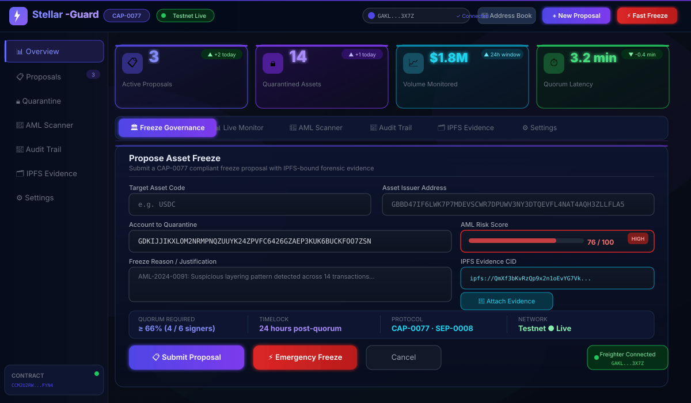
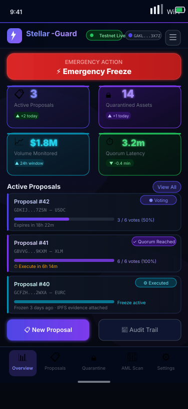

<div align="center">

# ⚡ Stellar-Guard

### CAP-0077 Multi-Signature Freeze Governance for Stellar

[](LICENSE)
[](https://stellar.expert/explorer/testnet/contract/CCM2U2RWZVKISBKOAUBCTSYA63GIYAVC4RRBZU4Q5KKY5ZOYN45LFYN4)
[](https://stellar-guard-frontend.vercel.app)
[](https://soroban.stellar.org)
[](https://stellar-guard-frontend.vercel.app)
[](docs/CAP_0077_QUARANTINE_SPEC.md)
[](https://github.com/Virelis/Stellar-Guard/actions)
[](<>)

**On-chain, multi-signature asset freeze governance — built for institutional compliance on the Stellar network.**

[🚀 Live Dashboard](https://stellar-guard-frontend.vercel.app) · [📖 Whitepaper](docs/WHITEPAPER.md) · [🏗️ Architecture](docs/ARCHITECTURE.md) · [🔐 Threat Model](docs/THREAT_MODEL.md) · [📋 CAP-0077 Spec](docs/CAP_0077_QUARANTINE_SPEC.md)

</div>

---

## 📌 The Problem

Crypto-asset service operators on Stellar face a critical compliance gap: **there is no standard, auditable, decentralized mechanism to freeze assets** suspected of AML violations. Existing approaches rely on:

- Centralized admin keys with no multi-party oversight
- Off-chain manual processes that leave no on-chain audit trail
- No quorum requirement — a single compromised key can freeze any asset

The result is a system that is either too slow (compliance teams waiting on single signers) or too dangerous (unilateral freeze power creates insider-threat risk).

## 💡 The Solution

**Stellar-Guard** implements [CAP-0077](docs/CAP_0077_QUARANTINE_SPEC.md) — a Soroban smart contract that enforces **quorum-based, timelocked, multi-signature governance** over asset freeze operations. Every proposal is:

- Submitted on-chain with cryptographically-bound IPFS forensic evidence
- Voted on by an authorized signer committee
- Executed only after ≥66% quorum is reached and a timelock window passes
- Permanently recorded in a full, exportable audit trail

---

## 🏗️ Architecture

```
┌─────────────────────────────────────────────────────────────────────┐
│                        STELLAR-GUARD SYSTEM                         │
├─────────────────────────────────────────────────────────────────────┤
│                                                                     │
│   ┌──────────────────┐         ┌──────────────────────────────┐    │
│   │  Operator Browser │         │       Freighter Wallet       │    │
│   │  (Next.js 14 UI)  │◄───────►│   (SEP-0010 WebAuth / Tx)   │    │
│   └────────┬─────────┘         └──────────────────────────────┘    │
│            │  REST + SSE                                            │
│   ┌────────▼─────────────────────────────────────────────────┐     │
│   │              Express / Node.js Backend                    │     │
│   │  ┌──────────┐  ┌──────────┐  ┌──────────┐  ┌─────────┐  │     │
│   │  │  RBAC    │  │  AML     │  │  Audit   │  │Prometheus│  │     │
│   │  │  Auth    │  │  Scoring │  │  Logger  │  │ Metrics  │  │     │
│   │  └──────────┘  └──────────┘  └──────────┘  └─────────┘  │     │
│   │  ┌──────────────────────┐    ┌─────────────────────────┐ │     │
│   │  │   SQLite (Audit DB)  │    │   IPFS Evidence Store   │ │     │
│   │  └──────────────────────┘    └─────────────────────────┘ │     │
│   └────────────────────────┬─────────────────────────────────┘     │
│                             │  Horizon RPC                          │
│   ┌─────────────────────────▼─────────────────────────────────┐    │
│   │              Soroban Smart Contract (WASM)                 │    │
│   │                                                            │    │
│   │  propose_freeze() ──► vote() ──► execute_freeze()         │    │
│   │  revoke_freeze()  ──► get_proposal() ──► get_quorum()     │    │
│   │                                                            │    │
│   │  CCM2U2RWZVKISBKOAUBCTSYA63GIYAVC4RRBZU4Q5KKY5ZOYN45LFYN4│    │
│   └────────────────────────────────────────────────────────────┘    │
│                         Stellar Testnet                             │
└─────────────────────────────────────────────────────────────────────┘
```

---

## ✨ Features

| Feature                          | Description                                                               |
| -------------------------------- | ------------------------------------------------------------------------- |
| 🔐 **CAP-0077 Quarantine**       | Propose, vote, and execute quorum-based asset freezes entirely on-chain   |
| 🗳️ **Dynamic Quorum (≥66%)**     | Configurable multi-sig threshold — no single point of freeze authority    |
| ⏱️ **Timelocked Execution**      | Mandatory delay between quorum and execution, preventing rushed freezes   |
| 🔏 **RBAC**                      | Role-based access control with operator, signer, auditor, and admin tiers |
| 🧾 **IPFS Evidence**             | Every proposal cryptographically binds IPFS-hosted forensic evidence docs |
| 🤖 **AML Risk Scoring**          | Automated risk engine flags addresses before proposals are submitted      |
| 📊 **Full Audit Trail**          | Immutable, exportable audit log with PDF export for regulators            |
| 🛡️ **SEP-0010 WebAuth**          | Stellar standard authentication — no passwords stored                     |
| 📜 **SEP-0008 Regulated Assets** | Full regulated asset lifecycle compliance                                 |
| 💼 **Freighter Wallet**          | Native browser wallet integration for signing governance transactions     |
| 📡 **Live Monitoring**           | Real-time SSE feed, Prometheus metrics endpoint, Winston structured logs  |
| 📱 **Mobile-Ready**              | Responsive operator dashboard works on any device                         |

---

## 📸 Screenshots

<div align="center">

### Operator Dashboard



### Mobile View



</div>

---

## 🚀 Quickstart

### Option A — Docker Compose (Recommended)

```bash
# Clone the repository
git clone https://github.com/Virelis/Stellar-Guard.git
cd Stellar-Guard

# Copy environment template
cp backend/.env.example backend/.env
# Edit backend/.env with your Stellar keypair and configuration

# Start everything (dashboard + backend + SQLite)
docker compose up -d

# Dashboard: http://localhost:3000
# Backend API: http://localhost:4000
# Prometheus metrics: http://localhost:9090
```

### Option B — Manual Setup

#### Prerequisites

- Node.js ≥ 18
- Rust + `cargo` (for contract builds)
- Stellar CLI (`stellar`) ≥ 21
- [Freighter Wallet](https://freighter.app) browser extension

#### 1. Install dependencies

```bash
# Install workspace dependencies from root
npm install

# Or per package:
cd backend && npm install
cd ../frontend && npm install
```

#### 2. Configure environment

```bash
cp backend/.env.example backend/.env
cp frontend/.env.example frontend/.env.local
```

| Variable             | Description                                                |
| -------------------- | ---------------------------------------------------------- |
| `STELLAR_NETWORK`    | `testnet` or `mainnet`                                     |
| `FREEZE_CONTRACT_ID` | `CCM2U2RWZVKISBKOAUBCTSYA63GIYAVC4RRBZU4Q5KKY5ZOYN45LFYN4` |
| `SERVER_SIGNING_KEY` | Your Stellar server signing secret key (for SEP-0010)      |
| `JWT_SECRET`         | Secret for JWT session tokens (≥ 32 chars)                 |
| `ADMIN_WALLETS`      | Comma-separated Stellar public keys with admin privileges  |

#### 3. Start the backend

```bash
cd backend
npm run dev
# API running at http://localhost:4000
```

#### 4. Start the dashboard

```bash
cd frontend
npm run dev
# Dashboard running at http://localhost:3000
```

---

## 🖥️ CLI Tool

Install the Stellar-Guard CLI globally for scripted governance operations:

```bash
npm install -g @stellar-guard/cli
```

### Usage

```bash
# Authenticate via SEP-0010 WebAuth
stellar-guard auth login --network testnet

# Submit a new freeze proposal
stellar-guard propose freeze \
  --asset USDC-GBBD47IF6LWK7P7MDEVSCWR7DPUWV3NY3DTQEVFL4NAT4AQH3ZLLFLA5 \
  --account GDKIJJIKXLOM2NRMPNQZUUYK24ZPVFC6426GZAEP3KUK6BUCKFOO7ZSN \
  --evidence ipfs://QmXf3bKvRzQp9x2n1oEvYG7VkPBspDdCLEnFDMkqE8y9Wz \
  --reason "AML-2024-0091: Suspicious layering pattern detected"

# List active proposals
stellar-guard proposals list --status active

# Cast a governance vote
stellar-guard vote cast --proposal-id 42 --choice approve

# Check quorum status
stellar-guard proposals quorum --id 42

# Execute a passed proposal (after timelock)
stellar-guard execute --proposal-id 42

# Export audit trail as PDF
stellar-guard audit export --format pdf --output report.pdf

# Stream live governance events
stellar-guard monitor --live
```

---

## 🌐 Live Deployment

| Component              | Network             | Address / URL                                                                                                                    |
| ---------------------- | ------------------- | -------------------------------------------------------------------------------------------------------------------------------- |
| **Soroban Contract**   | Stellar Testnet     | [`CCM2U2RW...LFYN4`](https://stellar.expert/explorer/testnet/contract/CCM2U2RWZVKISBKOAUBCTSYA63GIYAVC4RRBZU4Q5KKY5ZOYN45LFYN4)  |
| **Operator Dashboard** | Vercel (Production) | [stellar-guard-frontend.vercel.app](https://stellar-guard-frontend.vercel.app)                                                   |
| **Alt URL**            | Vercel (Production) | [stellar-guard-omolobamoyinoluwa-maxs-projects.vercel.app](https://stellar-guard-omolobamoyinoluwa-maxs-projects.vercel.app)     |
| **Contract WASM Hash** | —                   | `e2a544b76cfc3c002357f081c39a7af26a5c242bde8f06fec82f4d534be6b42f`                                                               |
| **WASM Size**          | —                   | 43.49 KB                                                                                                                         |
| **Init Transaction**   | Testnet             | [`bc20cb27...88b9`](https://stellar.expert/explorer/testnet/tx/bc20cb27a8dd0e21ea09d1da8ebeb77acace19b9b81f72397c112e9c228288b9) |

---

## 🔧 Tech Stack

| Layer                   | Technology                                                 |
| ----------------------- | ---------------------------------------------------------- |
| **Smart Contract**      | Soroban (Rust), Stellar Testnet                            |
| **Frontend**            | Next.js 14, TypeScript, Tailwind CSS, Glassmorphism UI     |
| **Backend**             | Express.js, Node.js, SQLite, Winston, Prometheus           |
| **Authentication**      | SEP-0010 WebAuth, JWT, Freighter Wallet                    |
| **Asset Standard**      | SEP-0008 Regulated Assets                                  |
| **Governance Protocol** | CAP-0077 Quarantine                                        |
| **Evidence Storage**    | IPFS                                                       |
| **Deployment**          | Vercel (dashboard), Docker Compose (self-hosted)           |
| **CLI**                 | `@stellar-guard/cli` (npm)                                 |
| **Monitoring**          | Prometheus metrics, Winston structured logs, SSE live feed |

---

## 📂 Project Structure

```
stellar-guard/
├── contract/               # Soroban smart contract (Rust)
│   ├── src/
│   │   └── lib.rs          # Contract entrypoints
│   └── Cargo.toml
├── dashboard/              # Next.js 14 operator UI
│   ├── app/
│   │   ├── page.tsx        # Main dashboard page
│   │   ├── layout.tsx      # Root layout
│   │   └── globals.css     # Global styles + animations
│   └── components/
│       ├── HeaderNav.tsx   # Glassmorphism header
│       ├── SidebarNav.tsx  # Collapsible sidebar
│       └── OverviewMetricCards.tsx
├── backend/                # Express API server
│   ├── routes/
│   ├── services/           # AML scoring, IPFS, audit
│   └── db/                 # SQLite schema + migrations
├── cli/                    # @stellar-guard/cli npm package
├── docs/
│   ├── WHITEPAPER.md
│   ├── ARCHITECTURE.md
│   ├── THREAT_MODEL.md
│   ├── CAP_0077_QUARANTINE_SPEC.md
│   └── screenshots/
│       ├── dashboard.svg
│       └── mobile_view.svg
├── docker-compose.yml
├── .env.example
└── README.md
```

---

## 🛡️ Security

Stellar-Guard is designed with a defense-in-depth approach:

- **No unilateral freeze authority** — all freezes require ≥66% multi-sig quorum
- **Timelock execution** — mandatory delay between vote passage and execution
- **IPFS-bound evidence** — forensic evidence is immutably linked to every proposal; tampering is cryptographically detectable
- **SEP-0010 WebAuth** — authentication is challenge-response signed by your Stellar keypair; no server ever sees your secret key
- **RBAC** — least-privilege role assignments: Auditors can only read; Operators can only propose; Signers can only vote; Admins manage membership
- **On-chain audit trail** — every governance action is recorded on Stellar's ledger and mirrored in the local SQLite audit DB
- **WASM integrity** — the deployed WASM binary is verifiable against the published hash: `e2a544b7...b42f`

### Reporting Vulnerabilities

Please do **not** open public GitHub issues for security vulnerabilities. Email the security team at `security@stellar-guard.io` with the subject line `[SECURITY]`. We aim to acknowledge reports within 48 hours.

See [THREAT_MODEL.md](docs/THREAT_MODEL.md) for a full threat analysis.

---

## 🤝 Contributing

Contributions are welcome! Here's how to get started:

```bash
# Fork and clone
git clone https://github.com/your-org/stellar-guard.git
cd stellar-guard

# Install all dependencies
npm run install:all

# Run tests
npm test

# Run linter
npm run lint

# Build contract (requires Rust + stellar CLI)
cd contract && cargo build --target wasm32-unknown-unknown --release
```

### Development Guidelines

- **Smart contract changes** must include unit tests in `contract/src/tests/`
- **Backend changes** must include integration tests and not break the audit trail schema
- **UI changes** should preserve the glassmorphism design language and dark-mode-first approach
- All PRs require at least one approval before merge
- Follow [Conventional Commits](https://www.conventionalcommits.org/) for commit messages

### Branch Strategy

| Branch    | Purpose                         |
| --------- | ------------------------------- |
| `main`    | Production-ready code           |
| `develop` | Integration branch for features |
| `feat/*`  | Feature branches                |
| `fix/*`   | Bug fix branches                |

---

## 📖 Documentation

| Document                                                        | Description                                               |
| --------------------------------------------------------------- | --------------------------------------------------------- |
| [WHITEPAPER.md](docs/WHITEPAPER.md)                             | Full protocol design rationale and economic model         |
| [ARCHITECTURE.md](docs/ARCHITECTURE.md)                         | Detailed system architecture and component diagrams       |
| [THREAT_MODEL.md](docs/THREAT_MODEL.md)                         | Security threat analysis, attack vectors, and mitigations |
| [CAP_0077_QUARANTINE_SPEC.md](docs/CAP_0077_QUARANTINE_SPEC.md) | CAP-0077 implementation specification                     |

---

## 📄 License

This project is licensed under the **MIT License** — see [LICENSE](LICENSE) for details.

---

<div align="center">

Built with ⚡ on [Stellar](https://stellar.org) · Secured by [Soroban](https://soroban.stellar.org) · Governed by [CAP-0077](docs/CAP_0077_QUARANTINE_SPEC.md) · [Live Dashboard](https://stellar-guard-frontend.vercel.app)

</div>
